# TV Debloat + Gallery Home

A reversible clean-up kit and a hand-built home screen for a Panasonic Android TV (SCBC R4, Android TV 11), all driven from a Mac over Wi-Fi with `adb`.

- **TV Debloat** switches off ads, telemetry, auto-installers and shop-demo apps. Nothing is uninstalled, every change is logged, and one command puts the TV back exactly as it was.
- **Gallery Home** replaces the stock launcher: a single line of app logos over rotating public-domain art, a big clock, Hong Kong Observatory weather and warnings, a Nest Mini mini player, and a live commute board.

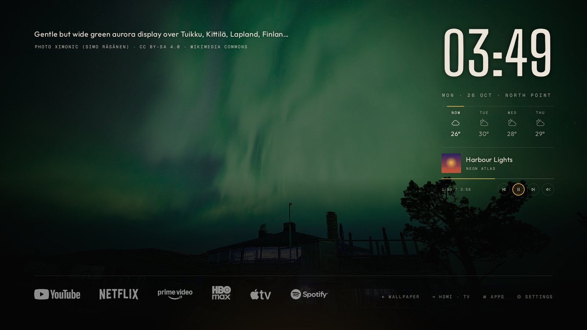

<table>
<tr>
<td width="50%">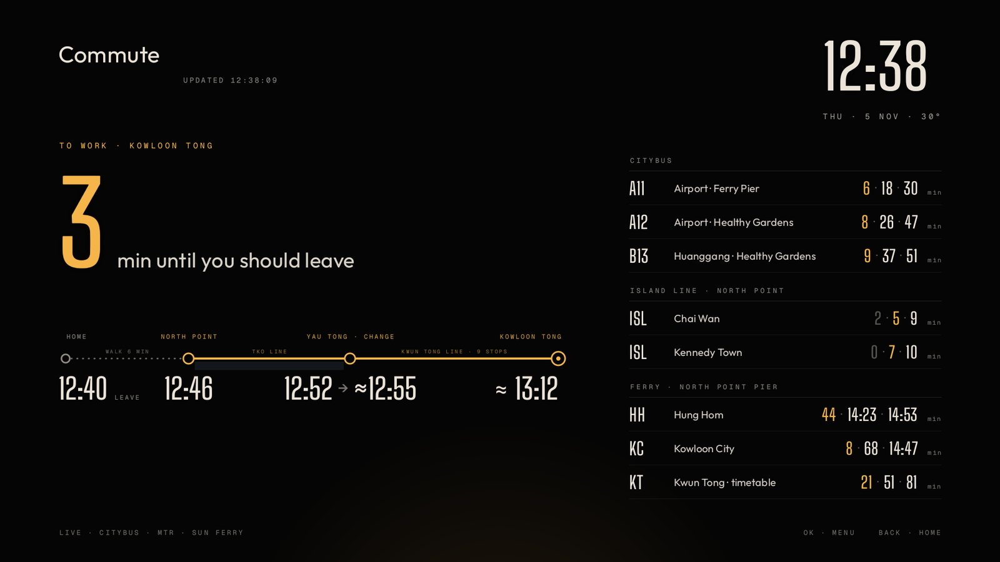<br><sub><b>Commute</b>: when to leave, the whole journey to work, and live buses, MTR and ferries</sub></td>
<td width="50%">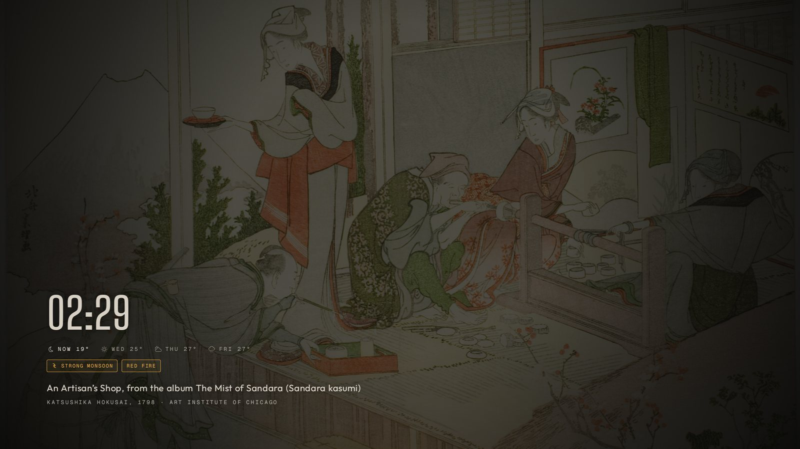<br><sub><b>Wallpapers</b>: Hokusai from the Art Institute of Chicago, dimmed to sit behind the clock</sub></td>
</tr>
<tr>
<td>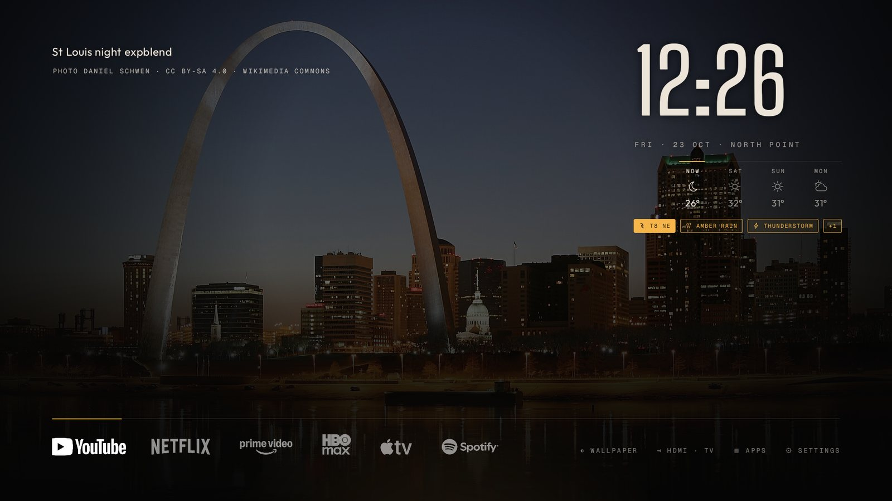<br><sub><b>Weather</b>: HKO now + 3 days, warnings and typhoon signals as amber badges</sub></td>
<td>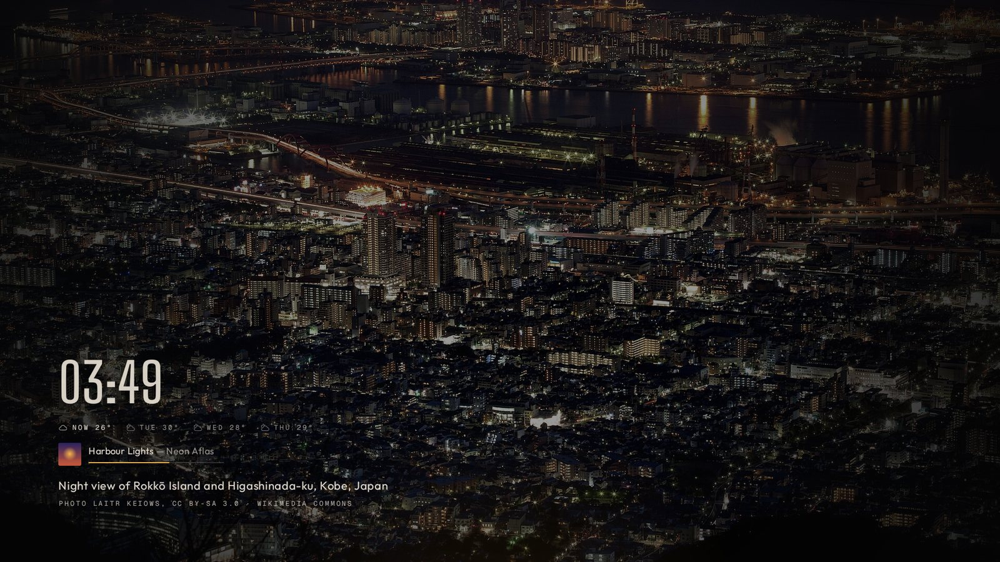<br><sub><b>Screensaver</b>: the art, the clock, and what's playing on the Nest Mini</sub></td>
</tr>
</table>

## Contents

- [What's in the repo](#whats-in-the-repo)
- [Getting started](#getting-started)
- [What the debloat changes](#what-the-debloat-changes)
- [Undo everything](#undo-everything)
- [tv.sh commands](#tvsh-commands)
- [Plan files](#plan-files)
- [Gallery Home](#gallery-home)
  - [Home screen and dock](#home-screen-and-dock)
  - [Wallpapers](#wallpapers)
  - [Weather](#weather)
  - [Nest Mini mini player](#nest-mini-mini-player)
  - [Commute board](#commute-board)
  - [Settings](#settings)
- [Building Gallery Home](#building-gallery-home)
- [Code tour](#code-tour)
- [Data sources and licences](#data-sources-and-licences)
- [Troubleshooting](#troubleshooting)
- [History](#history)
- [Not in this repo, and privacy](#not-in-this-repo-and-privacy)

## What's in the repo

| Path | What it is |
|---|---|
| `tv.sh` | Everything over adb: setup, connect, backup, screenshots, disable/enable, install, `apply <plan>`, `diag`, `doctor` |
| `restore.sh` | Undoes everything recorded in the backup's `changes.log` |
| `plan.txt` | The original debloat, as a step-by-step plan |
| `update-*.txt` | One plan per Gallery Home update, run with `tv.sh apply` (kept as a history) |
| `GalleryHome.apk` | The current build of the launcher (5.6.6) |
| `launcher/` | Gallery Home source: Java, no Gradle, built with `launcher/build.sh` |
| `docs/screens/` | Screenshots used in this README |
| `README.txt` | Short plain-text notes for using the TV day to day |

## Getting started

**On the TV:** Settings → Device Preferences → About → click *Build* 7 times to unlock Developer options. Then in Developer options turn on **USB debugging** (and **Network debugging**, if the TV lists it separately). adb then reaches the TV over Wi-Fi on port 5555; no cable is needed.

**On the Mac** (TV and Mac on the same Wi-Fi):

```bash
cd ~/Documents/"TV Debloat"
./tv.sh setup          # downloads Google's adb if needed, finds the TV, connects, backs up, takes a screenshot
```

The TV asks *Allow USB debugging?* the first time: tick **Always allow from this computer** and press OK.

`setup` saves a full backup to `tv-backup-<date>/` (package list, enabled/disabled state, settings, default home screen). **Every later change is logged there**, which is what makes the restore exact. Then:

```bash
./tv.sh apply plan.txt          # the debloat + Gallery Home, one checked step at a time
```

To update Gallery Home later, run the newest `update-*.txt` plan, or just `./tv.sh install GalleryHome.apk`.

## What the debloat changes

All with `pm disable-user --user 0`, which hides an app from the system without deleting it. Any of them can be switched back on with `./tv.sh enable <package>`.

| Group | Switched off |
|---|---|
| Google | TV recommendations (`tvrecommendations`), Feedback, Play Games, YouTube Music, Ambient mode (`backdrop`), the stock launcher (`tvlauncher`, the ad-filled home screen) |
| SCBC / Panasonic | Launcher customiser, partner auto-installer, GDPR/data consent app, E-Show and E-Sticker shop demos, Digital Signage, Meeting Mode (×2), World Clock |
| Other | HbbTV red button, print spooler, live-wallpaper picker |
| Later, by request | Apple TV (no longer subscribed) |

Settings changed (old values logged): window, transition and animator animation scales to 0.5×, and the screensaver set to Gallery Home.

The stock launcher is the last thing switched off, and the plan checks that the Home button really lands on Gallery Home first. If it doesn't, it switches the stock launcher back on and stops.

## Undo everything

```bash
./restore.sh                    # full restore: re-enables everything, restores settings and the stock home screen, removes Gallery Home
./restore.sh --keep-launcher    # restore apps and settings, keep Gallery Home
./restore.sh --dry-run          # only print what it would do
./tv.sh enable <package>        # re-enable a single app
```

`restore.sh` undoes `changes.log` line by line in reverse. As a safety net it then re-enables **any** package that was enabled at backup time but is disabled now, even ones the log doesn't mention.

## tv.sh commands

| Command | What it does |
|---|---|
| `setup` | One-step start: get adb, find the TV, connect, back up, screenshot |
| `find` | Scan the local network for devices with adb (port 5555) open |
| `connect <ip>` | Connect to the TV (remembered in `.tv_target`) |
| `doctor` | Explains why the TV can't be reached and what to do about it |
| `backup` | Full state backup into `tv-backup-<date>/` |
| `shot <name>` | Save a TV screenshot into the backup's `shots/` folder |
| `disable <pkg>…` / `enable <pkg>…` | Reversible disable / re-enable, logged |
| `setting <ns> <key> <value>` | Change a system setting, old value logged |
| `install <apk>` | Install or update an APK, logged |
| `home <component>` | Make an activity the default home screen, previous one logged |
| `apply <plan.txt>` | Run a plan file (below) |
| `diag` | Save Gallery Home's logs, its wallpaper log, network checks and the disabled-app list to the backup's `diag.txt` |
| `restore` | Same as `restore.sh` |

Environment: `TV=<ip:5555>` picks a device when several are connected; `BK=<dir>` picks a backup folder (default: the newest).

## Plan files

A plan is a plain text file of steps that `tv.sh apply` runs in order, printing each one. It stops at the first check that fails, so a half-applied change never goes unnoticed.

| Step | Meaning |
|---|---|
| `say <text>` | Print a heading |
| `install <apk> <package>` | Install or update an app |
| `disable <pkg>` | Disable an app (logged) |
| `launch <component> [am start extras]` | Start an activity, e.g. `tv.galleryhome/.HomeActivity --es wallpapers av-amber` |
| `key <KEYCODE>` | Press a remote key (`KEYCODE_HOME`, `KEYCODE_BACK`…) |
| `wait <seconds>` | Pause |
| `expect <text>` | Stop unless the foreground app matches |
| `running <package>` | Stop unless the app is running (catches crashes) |
| `guard <text> <pkg>` | If `<text>` isn't on screen, re-enable `<pkg>`, go Home and stop |
| `shot <name>` | Take a screenshot |
| `diag` | Save diagnostics |

Plans never press OK blindly on the TV. Anything that would need a click is reached through Gallery Home's test hooks instead (`--ez ambient true`, `--es open gh:commute`, `--es commutebg skyline`, and so on; see `HomeActivity.onNewIntent`).

## Gallery Home

A launcher written from scratch for this TV: a full-screen picture, the time, and as little else as possible. Default style is **Logo Line**; **Glass Orbs** and **Noir HUD** are alternatives in Settings.

### Home screen and dock

<table>
<tr>
<td width="50%">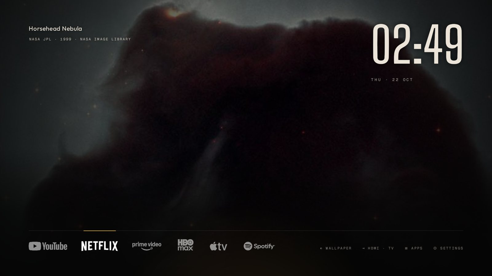</td>
<td width="50%">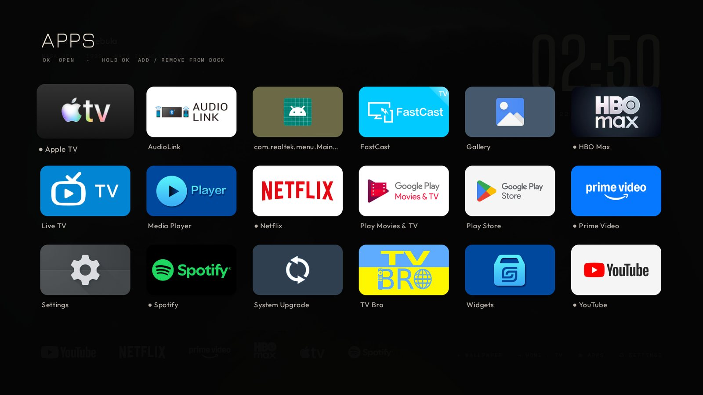</td>
</tr>
</table>

- The dock is a row of white app logos on a hairline; the focused app gets an amber underline.
- **Hold OK** (or Menu) on a dock app: move left/right, remove, app info.
- **APPS** lists every app; hold OK on one to add it to the dock.
- **WALLPAPER** hides everything except the picture and its caption; any button brings the screen back.
- **HDMI · TV** opens the TV's input picker.
- **COMMUTE** (the route-line icon) opens the commute board.

### Wallpapers

A new picture every few minutes (the interval is a setting), cross-faded and dimmed to its own brightness so the clock always reads. Every picture is captioned with its title, artist or photographer, and source. Any mix of sets can be ticked in Settings → Wallpapers:

| Set | Source | What it picks |
|---|---|---|
| Space | NASA Image Library | Nebulae and galaxies (Hubble, Webb) |
| Night cities | Wikimedia Commons | Skylines and harbours at night |
| Dark landscapes | Wikimedia Commons | Aurora, Milky Way, starry skies, blue hour |
| Museum paintings | Art Institute of Chicago, Cleveland Museum of Art | Nocturnes, seascapes, storms, winter |
| Artvee · Landscapes | Artvee | Landscapes and seascapes |
| Japanese prints · Artvee & museums | Art Institute of Chicago, Cleveland Museum of Art | Hiroshige, Hokusai, Kawase Hasui, Ohara Koson, Kobayashi Kiyochika… |
| Artvee · Vintage posters | Artvee | Posters from 1950 or earlier |
| Artvee · Illustrations & engravings | Artvee | Prints, drawings, book plates |
| Artvee · Amber nights | Artvee | Warm, dark pictures picked to suit a room lit with orange lamps |

<table>
<tr>
<td width="33%">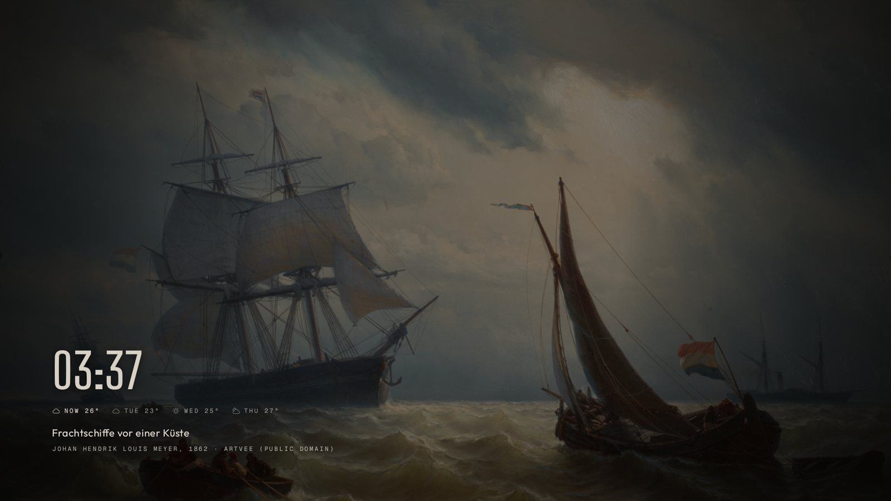</td>
<td width="33%">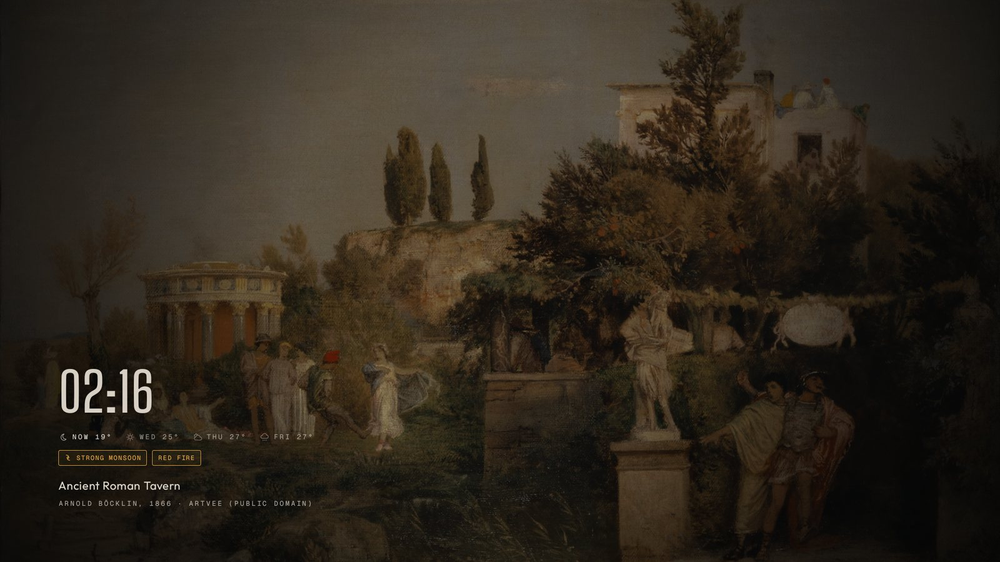</td>
<td width="33%"></td>
</tr>
</table>

How pictures are chosen:

- **Shape:** only landscape pictures (aspect 1.3 to 2.3) so nothing is badly cropped.
- **Brightness:** each picture's small preview is checked before the full image is downloaded. Too bright is skipped; pale prints and posters are allowed but dimmed more.
- **Amber nights:** the preview must be warm (more red than blue) and dark, or have a night/lamp/fire/autumn word in its title. Its categories are landscapes, Japanese prints, illustrations and still lifes.
- **Not wallpaper:** titles with alphabets, lettering, maps, diagrams, patterns or covers are skipped, and so are nudes (by title).
- **Clock corner:** for posters and illustrations, the bottom-left corner of each preview is measured for busyness and the calmer half are kept, so big lettering doesn't fight the clock.
- **Artvee** has no API, so its category pages are read directly (about 30 artworks per page, a random page each time). Its *Asian Art* listing comes back empty for this TV, so Japanese prints come from the two museums' open-access collections instead.
- Pictures are cached on the TV (up to 60), so the screen still changes when the internet is down.

### Weather

From the Hong Kong Observatory's open data, using the Happy Valley station (the nearest to North Point).

- Current temperature and a three-day forecast under the clock, with drawn icons.
- HKO warnings and typhoon signals appear as amber badges (strong monsoon, rainstorm, fire danger, typhoon signals…).
- Checked every minute, fetched every 10 minutes. Also shown in wallpaper mode and in the screensaver.

### Nest Mini mini player

Talks straight to the Nest Mini over Google Cast on the home Wi-Fi: no Google account, no cloud.

- Appears under the forecast whenever the speaker is playing (Spotify, YouTube Music, radio…): cover, song, artist, progress bar, and previous / play-pause / next / volume.
- From the dock press **UP** to reach it, **DOWN** or **BACK** to return.
- Volume: press OK on the volume button, then **LEFT/RIGHT** (5% steps), OK to finish.
- The remote's play/pause, next and previous keys control the speaker while the home screen is showing.
- Wallpaper mode and the screensaver show one line: cover, song, artist and progress.
- Finds the speaker by itself with mDNS and finds it again if its address changes. The TV only talks to the speaker while the home screen or the screensaver is on.

Under the hood: a TLS connection to port 8009 speaking the Cast v2 protocol (protobuf messages on the connection, heartbeat, receiver and media namespaces), hand-encoded without any Google library. The speaker's IPv4 address comes from a legacy-unicast mDNS query, because Android's own service discovery returns unusable link-local IPv6 addresses on this TV.

### Commute board

Opened from the dock. Everything is live from Hong Kong open data and refreshes on its own.

<table>
<tr>
<td width="50%">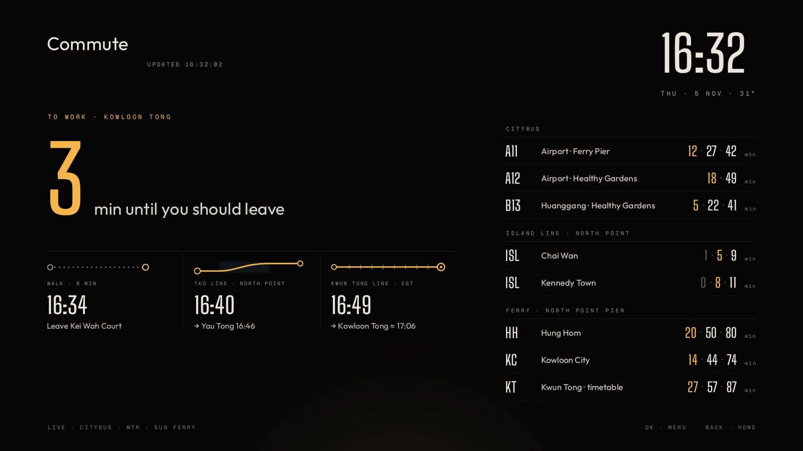</td>
<td width="50%">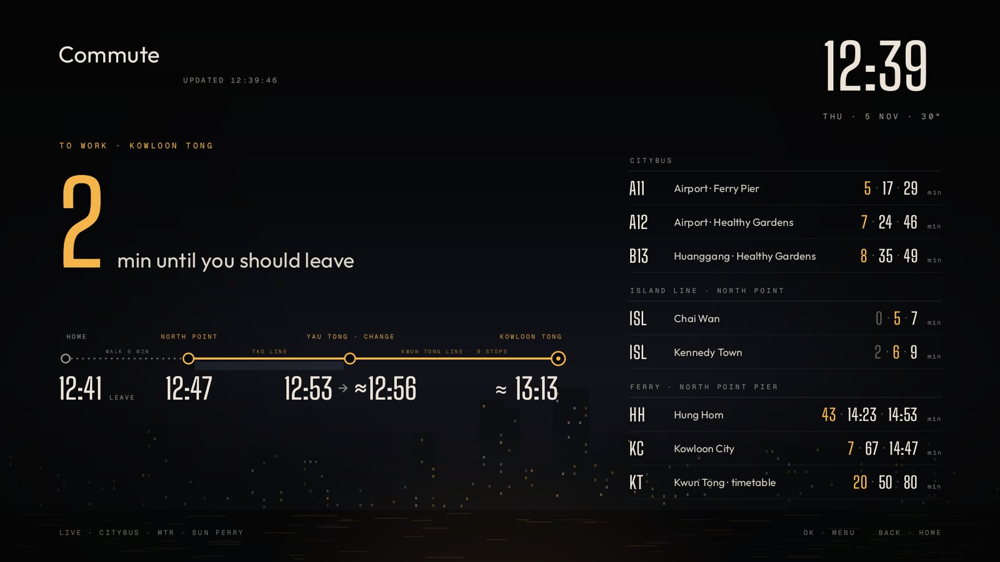</td>
</tr>
</table>

- **To work, first:** a large count of the minutes until you should leave for Kowloon Tong, then the journey: walk to North Point station, the TKO Line train, the Kwun Tong Line train it connects with at Yau Tong, and roughly when you arrive. Times marked ≈ are estimates.
- **Citybus:** A11 (from North Point Ferry Pier) and A12 / B13 (from the Healthy Gardens stop on King's Road), next three ETAs each. The nearest stop to home is worked out automatically from the route's stop list. More routes can be added to `BUSES` in `Commute.java`.
- **Island Line at North Point:** both directions (Chai Wan, Kennedy Town).
- **Ferries from North Point Pier:** Hung Hom and Kowloon City (Sun Ferry timetables plus live sailings and cancellations), Kwun Tong / Kai Tak (Fortune Ferry timetable, which has no reliable live feed). Weekday, Saturday and public-holiday timetables are chosen automatically.
- Departures you can't reach on foot in time are dimmed; the next one you can catch is amber.
- **OK** (or Menu) opens the board's menu:
  - *Refresh now*
  - *Journey style:* **Journey line** (one route line with the times under each stop) or **Steps with route** (three steps, each with its own piece of route)
  - *Background:* Ink, Sky by the hour (dawn → day → dusk → night), Weather (rain, cloud or stars from the HKO report), Contours, Light trails, Skyline, Sharp and dark, LED board
- **BACK** goes home. Choices are remembered.

### Settings

From the dock's **SETTINGS**: next wallpaper, which wallpapers, how often they change, brightness, captions on/off, style (Logo Line / Glass Orbs / Noir HUD), weather on/off, mini player on/off, reset dock, and a shortcut to Android TV's own settings.

## Building Gallery Home

No Android Studio or Gradle: just the Android command-line tools packaged by Debian/Ubuntu.

```bash
sudo apt install openjdk-17-jdk-headless aapt dalvik-exchange zipalign apksigner android-sdk-platform-23
cp /path/to/backup/galleryhome-signing.jks signing/      # or launcher/keystore.jks
cd launcher && ./build.sh                                  # → launcher/GalleryHome.apk
```

- Compiles against the API 23 `android.jar` with `javac -source 8`, so newer APIs (anything from API 24+) aren't available. Min SDK 21, target 28.
- Permissions: `INTERNET` and `ACCESS_NETWORK_STATE` only.
- Components: `HomeActivity` (the launcher, `category.HOME`), `CommuteActivity`, and `ArtDream` (the screensaver, a `DreamService`).
- **The signing key must stay the same.** Android won't install an update signed with a different key, so `build.sh` refuses to run without it rather than generating a new one.

## Code tour

`launcher/src/tv/galleryhome/`, about 6,200 lines:

| File | Role |
|---|---|
| `HomeActivity.java` | The launcher: dock, overlays, wallpaper cross-fades, weather and player panels, remote keys, settings menus, test hooks |
| `Art.java` | Wallpaper sources (NASA, Wikimedia, AIC, Cleveland, Artvee), preview checks, download cache, Artvee page parsing, the wallpaper log |
| `ArtDream.java` | The screensaver |
| `Weather.java`, `WeatherViews.java`, `WxIcon.java` | HKO data, forecast and warning badges, drawn weather icons |
| `Nest.java` | Finding the speaker, the Cast session, media status and controls |
| `CastLink.java` | TLS link to the speaker and the hand-coded Cast protobuf |
| `MdnsQuery.java` | Legacy-unicast mDNS query and DNS record parser |
| `NestViews.java` | Mini player panel and the one-line version |
| `Commute.java` | Citybus, MTR, ferry and holiday data; the work-journey calculation |
| `CommuteActivity.java` | The commute board and its menu |
| `CommuteBackgrounds.java`, `JourneyViews.java` | Board backgrounds; the two journey styles |
| `AppRepo.java`, `Logos.java`, `DockExtras.java` | Installed apps, white logos for the dock, the built-in dock items (Commute) |
| `Prefs.java` | Settings and the dock order, with migrations from older versions |
| `Noir.java`, `Ui.java` | Colours, fonts and small layout helpers |

Assets: fonts in `assets/fonts`, commute board overlays in `assets/bg`, the commute dock icon in `assets/logos`.

## Data sources and licences

| Data | Source |
|---|---|
| Weather, warnings | Hong Kong Observatory open data (`data.weather.gov.hk`) |
| Bus ETAs | Citybus open data (`rt.data.gov.hk`, DATA.GOV.HK) |
| MTR departures | MTR Next Train open data (`rt.data.gov.hk`) |
| Ferries | Sun Ferry live sailings; Sun Ferry and Fortune Ferry timetables (Transport Department) built into the app |
| Public holidays | 1823 (`1823.gov.hk`) |
| Wallpapers | NASA (public domain), Wikimedia Commons (each picture's CC licence, credited on screen), Art Institute of Chicago and Cleveland Museum of Art (public-domain / CC0 open access), Artvee (public domain) |
| Fonts | Big Shoulders, Geist Mono, Outfit, Jura, all SIL Open Font License (licence files in `launcher/assets/fonts`) |

## Troubleshooting

| Problem | Fix |
|---|---|
| `tv.sh` can't reach the TV | `./tv.sh doctor` explains what's wrong. If the TV's IP changed: `./tv.sh connect <new-ip>` |
| TV asks to allow debugging again | Tick *Always allow* and press OK, then rerun the command |
| Something on the TV looks wrong | `./tv.sh diag`, then read `tv-backup-*/diag.txt` (it includes Gallery Home's wallpaper log) |
| An app you need is missing | `./tv.sh enable <package>`; the package names are in `changes.log` |
| Commute board shows no MTR times | The MTR feed rate-limits; the board reuses the last schedule for 2 minutes and then retries |
| Mini player doesn't appear | The speaker must be playing; the TV only checks while the home screen or screensaver is showing |
| `build.sh`: *No signing key* | Copy `galleryhome-signing.jks` into `signing/` (see below) |

## History

| Change | Notes |
|---|---|
| Debloat + Gallery Home | `plan.txt`: apps switched off, faster animations, Gallery Home as home screen and screensaver |
| Styles | Noir HUD, Glass Orbs, then **Logo Line** as the default |
| Weather | HKO forecast, warnings and typhoon badges |
| Mini player (5.1) | Nest Mini over Google Cast; mDNS fix for this TV's IPv6 addresses |
| Commute (5.3–5.5) | Live board, crash fix (5.3.1), route-line dock icon, journey styles and eight backgrounds |
| Artvee wallpapers (5.6) | Five new sets; previews checked before download; Japanese prints from museums (5.6.6) |
| Tried and removed | A SPELUNKR web player in the dock (too clunky on the TV) |

Each step has its own `update-*.txt` plan in the repo.

## Not in this repo, and privacy

Kept out by `.gitignore`:

- `platform-tools/`: Google's adb, downloaded by `tv.sh setup`.
- `tv-backup-*/`: device backups, logs and screenshots.
- `.tv_target`: the TV's IP address.
- `signing/` and `*.jks`: **the signing key.** Keep a copy somewhere safe (a password manager or an encrypted drive). Without it, a new Gallery Home can't be installed over the current one; it would have to be uninstalled first, losing its settings. Keystore and key password `galleryhome`, alias `galleryhome`.

**Keep this repository private.** The commute code contains a home location (for walking times and the nearest bus stops) and the repo describes the TV and home network setup. The screenshots in `docs/screens` have the home name removed from the commute board.
